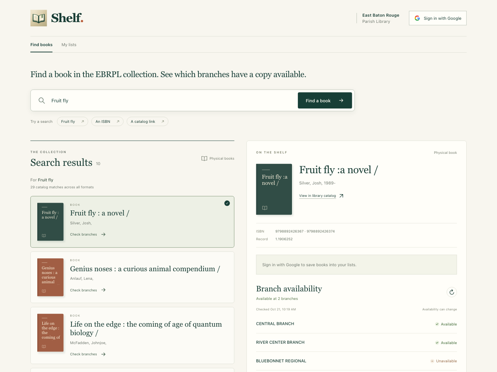
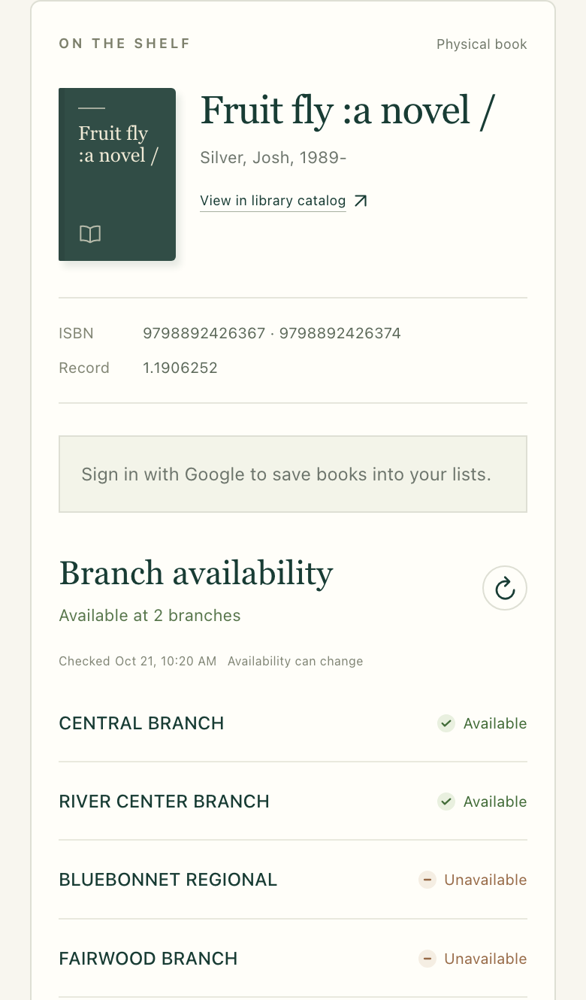

# Shelf

Get notified when your book is available at a library you choose.

[Open Shelf](https://shelf.gocloudlaunch.com)

## How it works

1. Search library catalogs by title, author, or ISBN and check where a physical copy is available.
2. Sign in with Google and save books to a list.
3. In **My lists**, turn on **Email alerts**, open a book’s **Branch alerts**, and save your chosen libraries.

Shelf checks availability hourly from 8 AM to 5 PM Central and emails you when a copy is available at a selected branch. You’ll also get an alert if a copy is already available when you subscribe.

Currently, only the East Baton Rouge Public Library system is supported.

Mobile view

## Development

See the [development guide](docs/development.md) for setup, builds, deployment, authentication, and the catalog API, or explore the [data model](docs/data-model.md).
