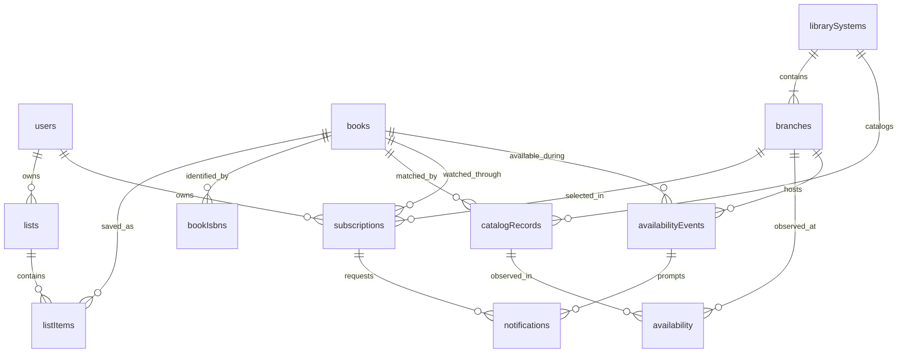

# Shelf data model

The [TypeScript scaffold](schema.ts) documents the agreed document shapes. It is included in the project typecheck, but does not create tables, configure auth, or change catalog behavior. When implemented, `convex/schema.ts` will define runtime validators and indexes. Application code will use its generated `Doc` and `Id` types.

Every document gets a generated Convex `_id` and `_creationTime`. Other timestamps are Unix milliseconds. ISBNs, provider account IDs, and library record IDs are external identifiers.

## Relationships

| Table | Purpose |
| --- | --- |
| `users` | Convex Auth profile and account-wide email preference |
| `lists` | A user's named book lists |
| `listItems` | Membership of a shared book in a list |
| `books` | Shelf's shared identity for confirmed physical editions in one language |
| `bookIsbns` | Canonical ISBN-13 identifiers linked to a Shelf book |
| `librarySystems` | Catalog adapter selection and backend URL configuration |
| `branches` | Individual locations within a system |
| `catalogRecords` | Confirmed physical catalog matches for a book and system |
| `subscriptions` | A user's alert choice for one book at one branch |
| `availability` | Latest observation of a catalog record at a branch |
| `availabilityEvents` | Shared periods when a book is available at a branch |
| `notifications` | Per-user email intent, send attempts, and provider submission result |

Convex Auth also manages provider accounts, sessions, and its other required tables. Those are omitted from the diagram and scaffold.

## Users, lists, and subscriptions

Use Convex Auth with Google sign-in. Its `users._id`, returned by `getAuthUserId(ctx)`, is the canonical Shelf user ID. Lists, subscriptions, and notifications reference that same ID.

`ShelfUserDoc` includes selected profile fields and app additions. Preserve the complete managed auth schema when extending it. Missing or pending `accessStatus` denies private account features. Treat a missing email preference as disabled.

A user can own multiple named lists. Each list contains a given book once. Books are shared across users, while lists and alert choices are private. Saving a book does not enable an alert by itself. Removing a list entry does not disable an independently selected subscription.

Each subscription selects one user, book, and branch. Email is the only initial channel, so subscription `isEnabled` controls its alerts and the user's `emailNotificationsEnabled` is the account-wide switch. Enforce one subscription per user/book/branch even when the book appears in several lists. Disable subscriptions in place so re-enabling one can reuse its notification history. A standalone library is one system with one branch.

The browser calls Convex functions through the SDK. Backend functions enforce ownership using the authenticated user. Validate list ownership through its parent list, and never trust a caller-supplied owner ID. Notification recipients must have active access, a verified account-owned email, and enabled account and subscription preferences.

## Book identity and catalog matching

Use `books._id` as the internal book ID. A Shelf book groups confirmed physical editions of the same work in the same language, including hardcover and paperback. ISBNs identify particular editions and formats. Multiple ISBNs and multiple records within one catalog can therefore link to one Shelf book. Never merge by title alone. Confirm matching metadata and keep ambiguous records separate.

`bookIsbns` supports indexed ISBN lookup. Validate checksums, remove separators, and convert valid ISBN-10 values to their equivalent ISBN-13 values. `catalogRecords.observedIsbns` preserves the identifiers reported by the catalog. Conflicting identifier ownership needs review before linking or merging books.

The current client accepts ISBN input through its catalog's keyword index. Results require full-record confirmation when brief responses omit identifiers. An ISBN search discovers source record IDs, which are still required for availability checks. One ISBN alone will not discover every physical edition of a work.

Each adapter resolves known ISBNs and confirms other physical-edition candidates. Store all confirmed matches and periodically refresh discovery so newly added records can be included. Keep metadata-only matches distinct from confirmed holdings. Physical catalog records belong to a book and a library system, with an external record ID unique within that system. Store one catalog record per system/external ID, rather than duplicating it for each ISBN or branch.

## Library configuration

`librarySystems` stores the adapter key and its typed configuration. The initial `iguana` adapter requires `landingUrl`, `searchUrl`, and `directoryUrl`. Additional adapters will extend the configuration types with their own required fields. A system's branches have internal IDs and that system's external branch codes.

Enter actual configuration values directly into the backend after deployment. Keep them out of committed seed data, examples, and documentation. Generate catalog links from adapter configuration and external record IDs. OAuth and email credentials belong in Convex environment variables.

Only admin/internal functions may edit catalog configuration. Validate fetch destinations, including redirects, and prevent users from supplying arbitrary fetch URLs. Return only the public catalog links needed by the frontend. Adapter request and parsing logic stays in TypeScript, while URL values come from backend configuration.

The existing catalog client still contains URL constants. Replacing those constants and adapting URL validation and link generation is implementation work after this scaffold.

## Observations and available periods

Schedule checks every 30 minutes from 8 AM through 5 PM daily in `America/Chicago`, respecting daylight saving time. Scheduler implementation is deferred. Poll each distinct catalog record once and share its observations across subscribers. Record attempts and sanitized errors separately from successful observations. Unknown, missing, and failed responses do not establish unavailability. Preserve the last known state through errors and reject stale check results.

Aggregate all confirmed physical records for each book/branch pair:

- Any confirmed available record makes the book available at that branch
- With at least one matching record, all must be confirmed unavailable or explicitly `not-held` before declaring the book unavailable
- Otherwise the result is unknown

Zero matching records yields unknown. `not-held` requires explicit confirmation from the catalog that the record is not held at that branch. Missing holdings remain unknown. The current parser reserves `not-held` and does not emit it yet.

Create an `availabilityEvents` document when availability is first confirmed with no open event. Its ID identifies that available period. Leave it open through unchanged availability and unknown results. Set `endedAt` only after confirmed unavailability. If availability returns later, create a new event. Check the latest event and open or close it in the same mutation so concurrent checks cannot create duplicate periods. Aggregate a coherent check batch before updating periods so partial or stale results cannot manufacture transitions.

An event belongs to the shared book/branch pair and contains no per-user send status. It can prompt notifications both when it starts and when a new person subscribes during the period.

## Notification eligibility and attempts

Keep a notification row for each user/book/branch/available-period/channel combination. Create it with `attemptCount: 0` and `status: 'pending'`. The corresponding subscription must match its user, book, and branch.

Reconcile eligible subscribers after checks and when subscriptions or email preferences are enabled. Confirm current availability with a sufficiently recent successful check, or schedule a fresh check before queueing. For each eligible subscriber, look up the notification key and insert only if absent. Insert the row and schedule its worker in the same mutation. Repeated unchanged checks and duplicate list membership create no additional notification.

| Situation | Result |
| --- | --- |
| Book first confirmed available and Alice is subscribed | Create the available period and Alice's notification |
| Next check remains available | Reuse the open period, no repeat for Alice |
| Bob subscribes while it remains available | Create Bob's notification for that same period |
| A check fails, then availability recovers unchanged | Keep the period, no repeat |
| Confirmed unavailable, then available again | Open a new period and notify eligible Alice and Bob again |

Before sending, recheck account access, email verification, preferences, subscription state, and whether the period is still current. Re-enabling a subscription reuses the notification for that period and preserves its attempt count and outcome.

- An unattempted `pending` row becomes `cancelled` when no longer eligible. It may return to `pending` if eligible again during the same period
- An attempted `failed` row stays `failed`. Disabling alerts clears `nextAttemptAt`, pausing retries without erasing the rejection. Re-enabling can set a new retry time if the period is still current, the rejection is safely retryable, and the retry budget remains
- A `sending` row keeps its in-flight state and records the eventual result. Disabling alerts prevents new attempts but cannot recall an email request already in flight
- `submitted` and `uncertain` rows retain their outcomes and are never automatically requeued for the same period

For example, definite rejection → retry scheduled on the failed row → alerts disabled → alerts re-enabled resumes only a safe retry with remaining budget. Classify retry eligibility from stable, sanitized `lastErrorCode` values. Unknown outcomes are `uncertain`, never a retryable rejection. Closed periods cannot produce further attempts, regardless of the notification's status.

| Status | Meaning |
| --- | --- |
| `pending` | Queued with no previous attempt |
| `sending` | A worker claimed the row and recorded a new attempt before contacting the provider |
| `submitted` | The provider accepted the email request |
| `failed` | A known rejection, with `nextAttemptAt` only when a safe bounded retry is scheduled |
| `uncertain` | The request may have been accepted, including a worker lost during sending |
| `cancelled` | An unattempted row that is no longer eligible |

Claim work transactionally, increment `attemptCount`, and set `lastAttemptAt` and a lease. Guard worker updates with the claimed attempt number so an older attempt cannot overwrite a newer result. A lost sending lease becomes uncertain. Do not automatically retry ambiguous outcomes. This tracks attempts and provider acceptance, without inbox delivery tracking or an exactly-once email guarantee.

## Indexes and mutation invariants

Implement these indexes alongside runtime validators:

| Table | Index fields |
| --- | --- |
| `lists` | userId |
| `listItems` | listId/bookId, bookId |
| `bookIsbns` | isbn13, bookId |
| `librarySystems` | code |
| `branches` | librarySystemId/externalId |
| `catalogRecords` | librarySystemId/externalId, bookId/librarySystemId, nextCheckAt |
| `subscriptions` | userId/bookId/branchId, bookId/branchId/isEnabled |
| `availability` | catalogRecordId/branchId |
| `availabilityEvents` | bookId/branchId/startedAt |
| `notifications` | userId/bookId/branchId/availabilityEventId/channel, subscriptionId, status/nextAttemptAt, status/leaseExpiresAt |

Indexes do not enforce uniqueness. Perform lookup and insert/update together in a mutation for list membership, ISBN ownership, external keys, subscriptions, observations, available periods, and notification deduplication. Validate referenced documents, ownership, and library-system consistency. Typed IDs alone do not enforce those relationships.

Retention must preserve open periods and the notification keys needed to prevent repeats. Prune closed periods and terminal notifications together only when no pending worker or reference needs them. Disable referenced systems, branches, and subscriptions before eventual cleanup.

## Deployment boundary

The static React frontend will use GitHub Pages over HTTPS with hash routing. Convex will host auth, database access, catalog actions, schedules, and email actions. Configure Vite's base and asset URLs for the hosting path, build with the backend's public `VITE_CONVEX_URL`, and keep provider secrets on the backend. This scaffold does not configure hosting or authentication.

## Sources

- [Convex document IDs](https://docs.convex.dev/database/document-ids)
- [Convex schemas and generated TypeScript types](https://docs.convex.dev/database/schemas)
- [Convex Auth user IDs](https://labs.convex.dev/auth/authz)
- [Customizing the Convex Auth schema](https://labs.convex.dev/auth/setup/schema)
- [Atomic scheduling from mutations](https://docs.convex.dev/scheduling/scheduled-functions#scheduling-from-mutations)
- [ISBN assignment by edition, language, and format](https://www.isbn-international.org/content/isbn-assignment)
